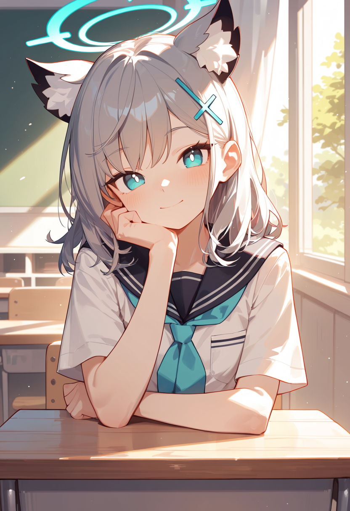

# Blue Archive Character LoRA (Anima)

A Blue Archive character LoRA trained on **Anima-Base v1.0** (2B), covering 23 characters. Works in ComfyUI with native Anima support.



## Usage

- **Base model**: Anima-Base v1.0 only (load as Diffusion Model) — **not** for SD1.5/SDXL
- **Text encoder**: `qwen_3_06b_base.safetensors` / **VAE**: `qwen_image_vae.safetensors`
- **Trigger word**: `bluearchive` (prefix of positive prompt)
- **Character tags**: pick from below (multi-char images may use several)

```
hina_(blue_archive)      plana_(blue_archive)     hoshino_(blue_archive)
iroha_(blue_archive)     miyu_(blue_archive)      arona_(blue_archive)
shiroko_(blue_archive)   serika_(blue_archive)    hifumi_(blue_archive)
maki_(blue_archive)      midori_(blue_archive)    momoi_(blue_archive)
natsu_(blue_archive)     mutsuki_(blue_archive)   hibiki_(blue_archive)
azusa_(blue_archive)     kisaki_(blue_archive)    koharu_(blue_archive)
kokona_(blue_archive)    mari_(blue_archive)      mika_(blue_archive)
reisa_(blue_archive)     tsubaki_(blue_archive)
```

## Recommended settings

| Setting | Value |
|---|---|
| Positive prefix | `masterpiece, best quality, score_7, safe, bluearchive,` + character tag |
| Negative | `worst quality, low quality, score_1, score_2, score_3, artist name, blurry, jpeg artifacts, chromatic aberration` |
| Sampler | `er_sde` (or euler) |
| Steps | 30~50 |
| CFG | 4~5 |
| Resolution | 832×1216 / 1024×1024 / 1216×832 |
| LoRA strength | 0.8 (tune 0.6~1.0) |

Tags are lowercase, space-separated; weight emphasis needs higher values than SDXL, e.g. `(chibi:2)`.

## Checkpoints

| File | Note |
|---|---|
| `bluearchive_lora-000001.safetensors` | epoch 1 — most flexible |
| `bluearchive_lora-000002.safetensors` | epoch 2 — middle ground |
| `bluearchive_lora.safetensors` | epoch 3 final — most complete, may overfit |

Try all three with the same prompt/seed; the best one is often not the final one.

**Download**: click a file above → **Raw** (or "Download raw file") to save the .safetensors.

## Training

232 Blue Archive character images, auto-captioned with PixAI Tagger v1.0; trained with sd-scripts `anima_train_network.py` (dim 8 / alpha 1, LR 1e-4, AdamW8bit, 3 epochs / 1392 steps).

## ⚠️ License (must keep when redistributing)

This LoRA is a **derivative work under the CircleStone Labs Non-Commercial License v1.2** (the license explicitly defines LoRAs as Derivatives):

- ✅ Allowed: personal use, study, research, non-profit sharing
- ❌ Not allowed: any direct or indirect commercial use

License text: https://huggingface.co/circlestone-labs/Anima/blob/main/LICENSE.md
